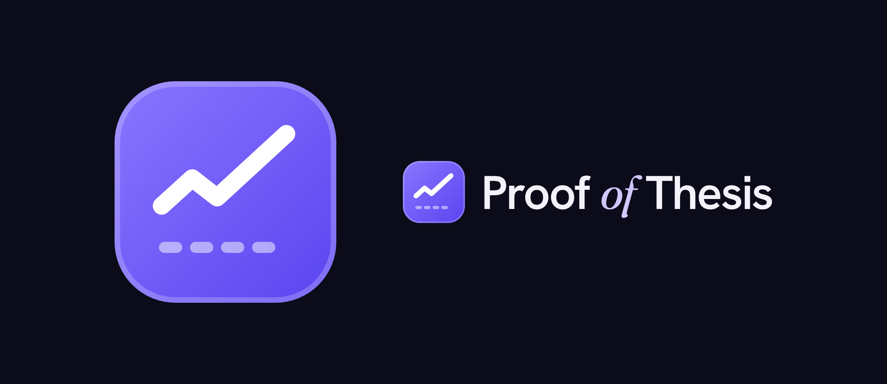

# Proof of Thesis

**A NEAR investment thesis that grades itself every day.**

Track: **Investment Thesis**, NEAR HACKATHON 2026.

Most investment theses are written once and never checked again. This one has six claims about why NEAR is worth owning. Each claim is tied to a live onchain number and a **kill criterion** written down in advance, a line that would prove it wrong. Every day a GitHub Action pulls fresh data, reruns the model, grades each claim as **holding**, **weakening** or **broken**, appends the result to an append-only ledger in git, and redeploys the dashboard.

It doesn't hide the weak parts. If NEAR's buybacks only cover a small slice of token issuance, the page says so, and shows how much Intents volume growth it would take to close the gap.

- **Live dashboard:** https://proof-of-thesis.netlify.app (mirror: https://gitkelv.github.io/Proof-of-thesis/). Both redeploy automatically after each daily run.
- **Model:** [`model/thesis.mjs`](model/thesis.mjs). One dependency-free file that runs in CI, in the tests and in the browser.

## The six claims

| Claim | Measured by | Proven wrong if |
|---|---|---|
| Intents demand is real and growing | 30-day NEAR Intents volume vs. the prior 30 days | volume falls more than 25% |
| Users pay for the service | Fees ÷ volume, 30 days (bps) | fee rate drops below 4 bps |
| NEAR captures part of it | Captured revenue ÷ gross fees, 30 days | NEAR's share falls below 10% |
| Buybacks are closing the inflation gap | Annualized buybacks ÷ annual issuance in USD, plus its 90-day change | coverage under 5% and not rising |
| Liquidity is sticky | NEAR Intents TVL, 30-day change | TVL falls more than 30% |
| NEAR is becoming a dollar venue | Stablecoin supply on NEAR, 90-day change | supply falls more than 15% |

Two broken claims and the verdict becomes **Thesis broken**. The thresholds are in one list (`CLAIMS` in `model/thesis.mjs`). If you disagree with one, change it and rerun.

## Try it (judges: start here)

Needs Node 18 or newer. No API keys, no `npm install` (there are no dependencies).

```bash
git clone https://github.com/gitkelv/Proof-of-thesis
cd proof-of-thesis
```

1. **Run the tests.** `npm test`
   You should see **12 passing tests**, covering the window math, growth fit, every kill threshold, the verdict rule, the projections and the API parsers.

2. **Grade the thesis offline.** `node scripts/run.mjs --fixture`
   You should see a verdict, six claims with `[HOLDING]`/`[WEAKENING]`/`[BROKEN]` tags, the deflation gap ("Net-deflation needs $X/day of Intents volume; today $Y/day"), and bear/base/bull projections. The header says **SYNTHETIC FIXTURE DATA**: this run uses invented numbers so it works without a network connection.

3. **Grade it on live data.** `node scripts/run.mjs`
   Same output, built from real data fetched from DefiLlama and a NEAR RPC node. It writes `site/data/latest.json`, `site/data/snapshot.json` (the raw inputs, so anyone can audit the run) and appends a row to `site/data/ledger.json`.

4. **Open the dashboard.** `npm run serve`, then open http://localhost:4173
   You should see the headline "The NEAR thesis that grades itself." next to a glass **Today's grade** card. Its six claim rows grade one by one and the verdict shows as *Intact*, *Under pressure* or *Broken*. The animated background is calm teal-violet when the thesis is intact, amber under pressure and red when broken. As you scroll, each claim card shows "Grading…" with a scan line, then stamps its status and draws its six-month sparkline against a dashed red kill line. The 26-week track-record grid fills in, the deflation-gap bars grow, and the method timeline lights up step by step. All motion is turned off if your system asks for reduced motion.

5. **Rerun it in your browser.** On the dashboard, press **Rerun it in your browser**.
   The page fetches live data straight from DefiLlama and NEAR RPC and runs the same `model/thesis.mjs` locally. The status line says "Regraded live in your browser at HH:MM". That proves the published grades aren't edited by hand.

6. **Test your own assumptions.** Open the **Your numbers** tab under *When does NEAR stop inflating?* and drag the sliders.
   The 12-month buybacks, the net supply change and the "time until buybacks outrun issuance" figure update instantly, along with the 36-month chart. A green dot marks the month buybacks cross issuance, if they do.

`npm run demo` does steps 2 and 4 in one go.

## How it works

```
GitHub Action (daily 06:17 UTC)
  └─ model/sources.mjs   fetch: DefiLlama (Intents volume, fees, revenue, holders revenue, TVL;
  │                       stablecoins on NEAR; NEAR price history) + NEAR RPC (total supply,
  │                       max inflation rate, read onchain)
  └─ model/thesis.mjs    metrics → claims → verdict → scenarios → 26-week backfill
  └─ site/data/*.json    committed to git (ledger.json is append-only)
  └─ GitHub Pages        site/ + model/ deployed as a static site
```

**The core calculation.** Since 23 February 2026, the revenue NEAR captures from Intents is used to buy NEAR on the open market. New NEAR is issued to validators at the onchain `max_inflation_rate`. So:

- yearly issuance in USD = total supply × inflation rate × price
- buybacks per $1 of volume = captured revenue ÷ volume (trailing 30 days)
- **deflation threshold** = issuance in USD per day ÷ buybacks per $1 of volume

The gap between that threshold and today's daily volume is the single number this thesis lives or dies on. The scenarios project volume at a constant monthly growth rate. Bear is −3% a month, base is half the trailing 180-day growth, bull is the full trailing rate. They hold the price flat.

**Track record.** On day one there's no ledger yet, so the model replays the same rules on the data as it stood each week for the last 26 weeks. From launch on, every daily run adds a real row to `site/data/ledger.json`.

## NEAR technology used

- **NEAR Intents.** The thesis is built on Intents volume, fees, captured revenue and verifier-contract TVL (`intents.near`, as tracked by DefiLlama), and on the Intents fee-to-buyback mechanism.
- **NEAR RPC.** `block` (header `total_supply`) and `EXPERIMENTAL_protocol_config` (`max_inflation_rate`) are read onchain, with fallback across `rpc.mainnet.near.org`, FastNEAR and Lava.
- **NEAR stablecoin supply** via DefiLlama's stablecoin tracker for the NEAR chain.

## Known limitations

- Buybacks use DefiLlama's holders-revenue series. If it's unavailable the model falls back to revenue and labels the run.
- `max_inflation_rate` slightly overstates real issuance when validators are offline.
- Supply on past dates is estimated by rolling today's onchain supply back at the inflation rate.
- Projections hold the NEAR price constant.
- This is an analysis tool, not financial advice.

## Layout

```
model/thesis.mjs     the model: metrics, claims, verdict, scenarios, backfill
model/sources.mjs    fetchers + parsers for every public source
scripts/run.mjs      CLI: fetch (or load fixture), grade, write site/data
scripts/serve.mjs    zero-dependency static server
scripts/make-fixture.mjs  regenerates the synthetic test fixture
site/                the dashboard (index.html, style.css, app.js, self-hosted fonts)
test/                node:test suite + synthetic fixture
.github/workflows/   daily grade + deploy, PR tests
```

MIT licensed.
